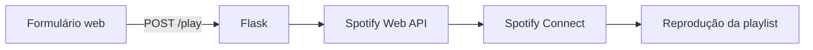

# CP2 - RPA utilizando Python

Aplicação web em Python que recebe a escolha de uma playlist e inicia sua reprodução em um dispositivo Spotify Connect por meio da Spotify Web API.

## Visão geral

O usuário autentica sua conta Spotify, escolhe uma das três playlists configuradas e seleciona o dispositivo de reprodução. O backend identifica a opção, transfere o playback para o dispositivo escolhido e solicita o início da playlist.



## Funcionalidades

- autenticação OAuth 2.0 com renovação automática do token;
- seleção entre três playlists configuráveis;
- listagem de dispositivos Spotify Connect disponíveis;
- transferência do playback para o dispositivo escolhido;
- nova tentativa automática em erros transitórios da API;
- mensagens para ausência de dispositivo, falhas de autorização e limite de requisições;
- credenciais e configurações isoladas em arquivo `.env`.

## Atendimento aos requisitos do CP2

| Requisito | Implementação |
| --- | --- |
| Linguagem | Lógica da automação e servidor desenvolvidos em Python. HTML e CSS são usados apenas na interface. |
| Integração externa | Consumo da Spotify Web API REST com a biblioteca `requests`. |
| Qualidade do código | Funções separadas para OAuth, tokens, chamadas HTTP, dispositivos e reprodução, com comentários nos pontos relevantes. |
| Dependências | Bibliotecas e versões declaradas em `requirements.txt`. |
| Entrega | Repositório sem credenciais, tokens, ambiente virtual ou arquivos temporários. |

## Tecnologias

- Python 3.11+
- Flask 3
- Requests
- python-dotenv
- Spotify Web API e Spotify Connect
- HTML e CSS

## Pré-requisitos

- Python 3.11 ou superior;
- conta Spotify Premium;
- Spotify Desktop, aplicativo móvel ou outro dispositivo Spotify Connect;
- aplicativo criado no [Spotify Developer Dashboard](https://developer.spotify.com/dashboard).

## Configuração do Spotify

1. Crie um aplicativo no Spotify Developer Dashboard e habilite a Web API.
2. Cadastre exatamente `http://127.0.0.1:5000/callback` em **Redirect URIs**.
3. Copie o Client ID e gere um Client Secret.
4. Use a conta proprietária do aplicativo ou autorize os usuários necessários no modo de desenvolvimento.
5. Crie ou revise três playlists adequadas à apresentação e copie suas URIs.

Uma URI de playlist tem o formato `spotify:playlist:ID_DA_PLAYLIST`.

## Instalação

No Windows PowerShell:

```powershell
python -m venv .venv
.\.venv\Scripts\Activate.ps1
python -m pip install -r requirements.txt
Copy-Item .env.example .env
```

Preencha o `.env`:

```dotenv
SPOTIFY_CLIENT_ID=seu_client_id
SPOTIFY_CLIENT_SECRET=seu_client_secret
SPOTIFY_REDIRECT_URI=http://127.0.0.1:5000/callback

PLAYLIST_1_URI=spotify:playlist:ID_DA_PLAYLIST_1
PLAYLIST_2_URI=spotify:playlist:ID_DA_PLAYLIST_2
PLAYLIST_3_URI=spotify:playlist:ID_DA_PLAYLIST_3
```

Nunca publique o `.env` ou o arquivo `.spotify_token.json`.

## Execução

```powershell
.\.venv\Scripts\Activate.ps1
python app.py
```

Acesse [http://127.0.0.1:5000](http://127.0.0.1:5000). Na primeira execução, clique em **Conectar Spotify** e autorize o aplicativo.

Antes da demonstração:

1. Abra o Spotify na mesma conta usada na autenticação.
2. Reproduza uma música por alguns segundos para ativar o dispositivo.
3. Mantenha a aplicação e o Spotify abertos.
4. Escolha a playlist e o dispositivo.
5. Clique em **Reproduzir playlist**.

## Testes

```powershell
python -m compileall -q app.py tests
python -m unittest discover -s tests -v
```

O teste automatizado valida a repetição da chamada de reprodução após uma falha transitória `500` da API.

## Diagnóstico

| Situação | Ação recomendada |
| --- | --- |
| `401` | Exclua `.spotify_token.json` e autentique novamente. |
| `403` | Confirme a assinatura Premium, o usuário autorizado e os scopes OAuth. |
| Nenhum dispositivo | Abra o Spotify e reproduza uma faixa manualmente. |
| `429` | Aguarde o período indicado no cabeçalho `Retry-After`. |
| `500`, `502`, `503` ou `504` | A aplicação faz até três tentativas antes de retornar o erro. |

## Estrutura do projeto

```text
spotify_rpa/
|-- app.py
|-- requirements.txt
|-- .env.example
|-- static/
|   `-- style.css
|-- templates/
|   |-- index.html
|   `-- result.html
|-- tests/
|   `-- test_playback.py
`-- Checkpoint_2_RPA_Spotify.docx
```

## Equipe

| Integrante | RM |
| --- | --- |
| Tomáz Versolato Carballo | 551417 |
| Rony Ken Nagai | 551549 |
| Aksel Viktor Caminha Rae | 99011 |
| Ian Xavier Kuraoka | 98860 |

## Possível adaptação para YouTube

A interface pode ser adaptada para selecionar playlists do YouTube, consultar seus dados pela YouTube Data API e reproduzi-las com a YouTube IFrame Player API. Diferentemente do Spotify Connect, esse modelo reproduziria o conteúdo no player web e estaria sujeito às regras de autoplay do navegador.
